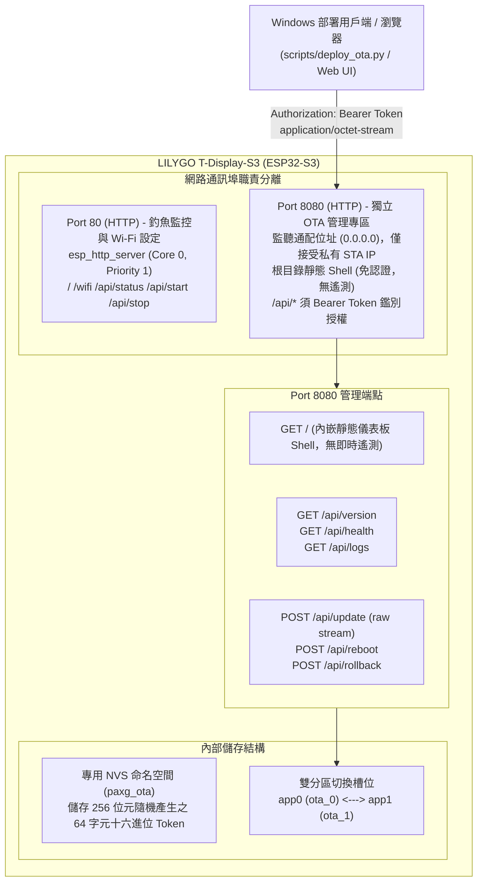

# PAXG-ticker ESP32-S3 無線韌體更新（OTA）建置與維護手冊

本手冊為 **PAXG-ticker** 專案整合韌體目標（`test/arduino_idf_integration_poc`，環境 `esp32s3_arduino_idf_poc`，ESP-IDF 5.1.2 搭配組件 Arduino-ESP32 3.0.7）之無線更新（OTA）架構規格、初次燒錄程序、用戶端部署操作、網路安全架構與故障排除指南。

> [!NOTE]
> 根目錄之傳統 Arduino 目標（`lilygo-t-display-s3`）維持其既有之 USB 燒錄工作流程不變。本文檔所提及之所有實機更新流程、路由通道與手勢均標記為【待實機驗收】；先前的實機測試數據（2026-11-20）僅作為歷史參考，不代表當前整合建置或新網路路由之實機測試結論。

---

## 目錄

1. [系統架構與連接埠設計](#1-系統架構與連接埠設計)
2. [硬體規格與記憶體分割區（Flash Partitions）](#2-硬體規格與記憶體分割區flash-partitions)
3. [初次 USB 燒錄程序（必要步驟）](#3-初次-usb-燒錄程序必要步驟)
4. [Windows OTA 部署用戶端使用說明](#4-windows-ota-部署用戶端使用說明)
5. [開機驗證與 Bootloader 自動回退（Rollback）機制](#5-開機驗證與-bootloader-自動回退rollback機制)
6. [遠端私有網路連線（Cloudflare Tunnel 與 WARP）](#6-遠端私有網路連線cloudflare-tunnel-與-warp)
7. [已知限制與安全威脅模型](#7-已知限制與安全威脅模型)
8. [實機驗收待辦清單（Checklist）](#8-實機驗收待辦清單checklist)
9. [常見問題與故障排除（Troubleshooting）](#9-常見問題與故障排除troubleshooting)

---

## 1. 系統架構與連接埠設計

韌體採用雙 HTTP 伺服器架構，嚴格劃分監控與管理職責：



### 1.1 雙連接埠職責分離
- **連接埠 80（Port 80）**：
  - 專用於釣魚狀態儀表板、即時控制與 Wi-Fi 設定救援頁面（`/wifi`）。
  - 運行於 Core 0 優先級 1，設計上低於 TinyUSB 等時音訊任務優先級 5，以降低執行緒競爭。
- **連接埠 8080（Port 8080）**：
  - 原生 `esp_http_server` 監聽於通配位址（`0.0.0.0`），但各請求處理常式（handlers）僅接受來自私有 STA 介面與本機 IP 的連線。
  - **根目錄（`/`）**：提供唯讀的靜態前端儀表板外殼，直接內嵌於韌體唯讀資料段（rodata），不依賴 SPIFFS 檔案系統，且未認證時絕不洩漏系統內部即時遙測資料。
  - **API 端點（`/api/*`）**：全數受獨立 64 字元十六進位 Bearer Token 保護（256 位元熵，`Authorization: Bearer <token>`），未通過認證即回傳 `401 Unauthorized`。

### 1.2 RESTful API 端點定義（Port 8080）

| 方法 | 路徑 | 認證要求 | 說明 |
|:---|:---|:---|:---|
| **GET** | `/` | 公開存取 | 內嵌靜態儀表板外殼（無即時數據洩漏） |
| **GET** | `/api/version` | Bearer Token | 取得 Device ID（12 位十六進位 STA MAC）、Boot ID、專案名稱、韌體版本（格式為 `ota1-<commit12>[-dirty]`，包含 12 位十六進位穩定 commit hash）、ELF 雜湊與活動槽位 |
| **GET** | `/api/health` | Bearer Token | 查詢系統內部健康狀態（`healthy: true/false`、heap 餘量、uptime 等） |
| **GET** | `/api/logs` | Bearer Token | 取得記憶體內日誌環形緩衝區記錄 |
| **POST** | `/api/update` | Bearer Token | 串流寫入新韌體二進位資料（需 `Content-Length` 與 `X-Firmware-SHA256`） |
| **POST** | `/api/reboot` | Bearer Token | 觸發裝置受控重新開機 |
| **POST** | `/api/rollback`| Bearer Token | 手動請求切換回上一版可用韌體（需中繼資料支援） |

### 1.3 認證權杖與實體螢幕顯示規格
1. **隨機權杖儲存**：裝置啟動時於專用 NVS 命名空間產生 256 位元（32 位元組，編碼為 64 個十六進位字元）隨機字串，與一般 Wi-Fi 設定資料隔離。
2. **實體螢幕檢視合約（預期操作規格，【待實機驗收】）**：
   - 觸發方式：於 **PAXG 行情畫面長按 UP 鍵 3 秒（Hold UP 3 seconds from PAXG Market screen）**。
   - 顯示內容：LCD 螢幕以暫態疊加層（time-limited overlay，具自動超時關閉機制）顯示 64 個十六進位字元之 OTA Token（分成四行顯示，每行 16 字元）以及 12 位十六進位 STA MAC 之硬體 Device ID（例如 `0123456789ab`）。
   - 安全原則：權杖嚴禁透過任何未經授權的網路通道明文回傳或輸出。

### 1.4 Web 儀表板操作指南（Web Dashboard via Private STA）
除了使用命令列工具外，使用者亦可透過同一局域網的瀏覽器進行圖形化管理：
1. **開啟頁面**：於連線至同私有網路（STA）之瀏覽器開啟 `http://<TARGET_DEVICE_IP>:8080/`（例如 `http://192.168.1.50:8080/`）。
2. **輸入 Token 與檢視狀態**：於頁面貼上自實體 LCD 螢幕取得之 64 字元十六進位 Token，點擊檢驗以安全載入內部健康度、版本與運行槽位（未驗證前頁面不顯示即時遙測）。
3. **選取韌體與校驗上傳**：選擇欲更新之 `firmware.bin`，儀表板將於用戶端即時計算 SHA-256 摘要並顯示傳輸進度百分比。
4. **驗收與切換控制**：更新完成並等待受控重啟後，檢查開機驗證狀態、新啟用槽位與穩定版本號；儀表板同時提供手動 Restart（重開機）與 Rollback（雙槽回退）控制項。

### 1.4 網路安全不變量
- **僅限私有位址**：目標位址必須為 RFC 1918 私有範圍（`10.0.0.0/8`, `172.16.0.0/12`, `192.168.0.0/16`）或本機/link-local。嚴禁公開網域或路由器連接埠轉發（Port Forwarding）。
- **拒絕 mDNS 與廣播**：用戶端強制拒絕 `*.local` 網域名稱，不啟用 UDP 廣播或 ArduinoOTA。

---

## 2. 硬體規格與記憶體分割區（Flash Partitions）

### 2.1 硬體規格
- **晶片**：ESP32-S3 (Dual-core Xtensa LX7 @ 240 MHz)
- **快閃記憶體（Flash）**：16 MiB
- **外部記憶體（PSRAM）**：8 MiB Octal SPI (OPI)
- **顯示器**：1.9 吋 ST7789 並列 8-bit TFT LCD (320x170)
- **硬體參考**：[LILYGO T-Display-S3 原廠手冊](https://wiki.lilygo.cc/products/t-display-series/t-display-s3/)

### 2.2 快閃記憶體分割區精確計算（16 MiB Flash Partition Math）
專案維持 `test/arduino_idf_integration_poc/partitions.csv` 既有配置，各分區偏移與大小連續無間隙，總和精確為 16 MiB（`0x1000000` 位元組）：

| 分割區名稱 | 類型 | 子類型 | 偏移位址 (Offset) | 大小 (Size) | 位元組換算 | 說明與用途 |
|:---|:---|:---|:---|:---|:---|:---|
| `nvs` | `data` | `nvs` | `0x9000` | `0x5000` | 20 KiB | Wi-Fi 憑證、校準資料與 OTA 權杖 |
| `otadata` | `data` | `ota` | `0xe000` | `0x2000` | 8 KiB | ESP-IDF 雙槽開機狀態與回退中繼資料 |
| `app0` | `app` | `ota_0` | `0x10000` | `0x640000` | 6.25 MiB | 第一個應用程式執行槽位 |
| `app1` | `app` | `ota_1` | `0x650000` | `0x640000` | 6.25 MiB | 第二個應用程式執行槽位（OTA 輪替寫入） |
| `spiffs` | `data` | `spiffs` | `0xc90000` | `0x360000` | 3.375 MiB | 既有保留分區（儀表板前端內嵌於韌體，不由此載入） |
| `coredump` | `data` | `coredump` | `0xff0000` | `0x10000` | 64 KiB | 系統異常崩潰核心傾印資料 |

計算檢驗：
- `0x9000` + `0x5000` = `0xe000`
- `0xe000` + `0x2000` = `0x10000`
- `0x10000` + `0x640000` = `0x650000`
- `0x650000` + `0x640000` = `0xc90000`
- `0xc90000` + `0x360000` = `0xff0000`
- `0xff0000` + `0x10000` = `0x1000000`（16,777,216 位元組 = 16 MiB）

---

## 3. 初次 USB 燒錄程序（必要步驟）

> [!CAUTION]
> **初次升級至整合韌體必須執行完整 USB 寫入，絕不能僅燒錄單一應用程式（Not an app-only flash）！**
> 
> 快閃記憶體中可能殘留傳統韌體的 `otadata` 狀態。若僅寫入 `app0`，舊的 `otadata` 可能指示開機載入未經初始化的 `app1`，導致開機失敗。

### 3.1 建置工具行為與安全原則
1. **已驗證之建置工具行為**：經查證 PlatformIO 6.5.0 espressif32 ESP-IDF 建置原始碼，建置流程會明確產生抹除態的 `ota_data_initial.bin`，並在 upload 時將其附加至 `0xe000` 位址寫入。
2. **完整寫入範圍**：Bootloader (`0x0`)、Partition Table (`0x8000`)、`app0` (`0x10000`) 與 `otadata` (`0xe000`)。
3. **保留 NVS 與 SPIFFS**：**嚴禁執行全盤抹除（`erase_flash`）**，以避免遺失出廠校準與 Wi-Fi 連線認證。

### 3.2 既有 Worktree 殘留組態處置（sdkconfig 檢查）
若當前工作目錄先前曾執行舊版建置（例如舊有的 2MB 或未啟用回退設定之目標），可能會在 `test/arduino_idf_integration_poc/` 殘留已產生的 `sdkconfig.esp32s3_arduino_idf_poc`（此檔已被 `.gitignore` 排除）。
- **單次備份移出**：在建置前若發現此檔案存在，請**僅將該檔案單次移動至倉庫外的暫存目錄**（例如 `$env:TEMP`）備份，**切勿執行全倉庫清理（No repository-wide cleanup）**：
  ```powershell
  # 若存在舊殘留組態，單次移至暫存目錄備份
  $oldSdkconfig = "test/arduino_idf_integration_poc/sdkconfig.esp32s3_arduino_idf_poc"
  if (Test-Path $oldSdkconfig) {
      Move-Item $oldSdkconfig "$env:TEMP/sdkconfig.esp32s3_arduino_idf_poc.bak"
  }
  ```
- **配置檢查確認**：建置過程中由 `sdkconfig.defaults` 重新產生新組態，請確認生成的應用程式與 bootloader 支援 16MB Flash（`CONFIG_ESPTOOLPY_FLASHSIZE_16MB=y`）及雙槽回退機制（`CONFIG_BOOTLOADER_APP_ROLLBACK_ENABLE=y`）。

### 3.3 預防性備份（建議執行）
在進行初次寫入前，建議使用 PlatformIO 虛擬環境內建之 Python/esptool 進行備份，並將備份檔案儲存於倉庫之外（例如 `$env:TEMP` 或使用者備份目錄）：

```powershell
# 定位 PlatformIO 虛擬環境之 Python 直譯器（路徑請依本機安裝為準）
$pioPython = "$env:USERPROFILE\.platformio\penv\Scripts\python.exe"
if (-not (Test-Path $pioPython)) { $pioPython = "python" }

# 備份既有 NVS 分割區 (0x9000, 長度 0x5000) 至倉庫外暫存目錄
& $pioPython -m esptool --chip esp32s3 --port COMx read_flash 0x9000 0x5000 "$env:TEMP\backup_nvs.bin"

# 備份舊有 otadata 分割區 (0xe000, 長度 0x2000) 至倉庫外暫存目錄
& $pioPython -m esptool --chip esp32s3 --port COMx read_flash 0xe000 0x2000 "$env:TEMP\backup_otadata.bin"
```

### 3.4 執行完整初次 USB 燒錄
經使用者授權後執行：

```powershell
pio run -d test/arduino_idf_integration_poc -e esp32s3_arduino_idf_poc -t upload --upload-port COMx
```

---

## 4. Windows OTA 部署用戶端使用說明

專用部署工具 `scripts/deploy_ota.py` 採用 Python 3 標準函式庫實作，無需額外安裝第三方套件。

### 4.1 命令列參數旗標（CLI Flags）
- `--host <IP>`：目標裝置私有 IPv4 位址（無預設值，網路操作必要參數）。強制拒絕公開 IP 與 `*.local`。
- `--port <PORT>`：OTA 連接埠，預設為 `8080`。
- `--env <ENV>`：PlatformIO 環境名稱，預設為 `esp32s3_arduino_idf_poc`。
- `--build`：部署前自動調用 PlatformIO 執行韌體編譯。
- `--firmware <PATH>`：自訂 `.bin` 檔案路徑（預設為 `.pio/build/<env>/firmware.bin`）。
- `--timeout <SEC>`：重新開機與健康驗收等待逾時，預設為 `60.0` 秒。
- `--status-only`：僅查詢並輸出裝置版本與健康度狀態，不執行更新。
- `--dry-run`：離線驗證模式（檢驗二進位魔術字元、ESP32-S3 chip_id 9、esp_app_desc 結構與 SHA-256），無需指定 `--host`。
- `--device-id <ID>`：**實體連線部署之強制鎖定旗標（Live upload REQUIRES device pin）**。若裝置回報之識別碼不符，立即中止部署。

### 4.2 認證金鑰安全載入（PowerShell 遮蔽式輸入）
**嚴禁在終端機命令列明文輸入金鑰**。請使用 PowerShell 7 遮蔽式輸入，並於完成部署後立即自環境變數清除：

```powershell
# 透過遮蔽式輸入提示讀取 64 字元十六進位 Token，避免外洩於歷史紀錄
$env:PAXG_OTA_TOKEN = Read-Host "請輸入裝置 LCD 顯示之 64 字元 OTA Token" -MaskInput
```

### 4.3 本地私有組態檔 `ota-deploy.local.ini`（已被 Git 排除）
若不想每次手動輸入參數，可在專案根目錄建立 `ota-deploy.local.ini`：
```ini
[ota]
host = 192.168.1.50
port = 8080
env = esp32s3_arduino_idf_poc
expected_device_id = 0123456789ab
timeout = 60.0
```

### 4.4 傳輸協定與韌體版本格式
- **傳輸協定**：HTTP POST `/api/update`，串流傳送 `application/octet-stream`，附帶 `Content-Length` 與 `X-Firmware-SHA256` 標頭。嚴格禁止跟隨 HTTP 轉址。
- **韌體版本字串規範**：格式為 `ota1-` 加上 12 位十六進位穩定 commit hash 預覽版本字串與可選之髒污標記（例如 `ota1-ce43b44d1e2f` 或 `ota1-ce43b44d1e2f-dirty`）；Device ID 則規範為 12 位十六進位之 STA MAC 位址（例如 `0123456789ab`）。系統另行分別記錄完整 Commit 雜湊與 ELF 摘要（`elf_sha256`）。

### 4.5 常用操作指令範例

以下範例提供直接可貼上執行之變數定義（請視實際網路環境置換變數值，無未加引號之角括號佔位符）：

```powershell
# 1. 離線本地二進位檔檢查 (無需裝置連線)
python scripts/deploy_ota.py --dry-run

# 2. 定義裝置連線參數（範例值，請依實際裝置替換）
$otaHost = '192.168.1.50'
$otaDeviceId = '0123456789ab'

# 3. 僅查詢裝置狀態 (安全連線)
python scripts/deploy_ota.py --host $otaHost --status-only

# 4. 遮蔽輸入 Token、自動編譯部署並於完成後清除環境變數 (必須帶有 --device-id 鎖定硬體)
$env:PAXG_OTA_TOKEN = Read-Host "請輸入裝置 LCD 顯示之 64 字元 OTA Token" -MaskInput
python scripts/deploy_ota.py --host $otaHost --device-id $otaDeviceId --build
Remove-Item Env:PAXG_OTA_TOKEN
```

---

## 5. 開機驗證與 Bootloader 自動回退（Rollback）機制

### 5.1 重啟後 7 點驗收標準
上傳完成後裝置重啟，部署用戶端輪詢驗證以下 7 項指標：
1. **網路服務復原**：Port 8080 恢復回應。
2. **Boot ID 變更**：新回應的 `boot_id` 與更新前不同。
3. **槽位成功翻轉**：例如由 `ota_0` 成功切換為 `ota_1`。
4. **系統健康度確認**：`/api/health` 回傳 `healthy: true`。
5. **專案名稱吻合**：`project_name` 嚴格匹配 `esp32s3_arduino_idf_poc`。
6. **版本字串吻合**：`version` 匹配 `ota1-<commit>`。
7. **ELF SHA-256 吻合**：`/api/version` 回報之 `elf_sha256` 與二進位檔中繼資料完全一致。

### 5.2 傳輸完整性 vs 數位簽章
- **`X-Firmware-SHA256`**：僅用於**傳輸完整性**檢驗，防止傳輸斷線或資料位元翻轉。
- **韌體數位簽章（Secure Boot）**：屬於硬體級密碼學防篡改機制。本手冊說明之流程為傳輸層校驗，非 Secure Boot 數位簽章。

### 5.3 ESP-IDF 原生 Rollback 運作機制
ESP-IDF 回退機制需同時依賴韌體設定（`CONFIG_BOOTLOADER_APP_ROLLBACK_ENABLE=y`）與已燒錄之 Bootloader：
- 新韌體首次開機時狀態為 `ESP_OTA_IMG_NEW`。
- 系統通過內部軟體診斷後，呼叫 `esp_ota_mark_app_valid_cancel_rollback()` 將狀態更新為 `ESP_OTA_IMG_VALID`。
- 若在確認前發生系統崩潰、例外重啟或看門狗逾時，Bootloader 會在重開機時自動將該槽位標記為無效，並回退至上一版本槽位。
- **健康檢查範圍**：僅評估核心任務與系統內部資源，**不包含**實體 USB 主機連線或外部音訊串流狀態。
- **手動回退限制**：僅在前一分區具備有效、相容之 OTA 中繼資料時，手動呼叫 `/api/rollback` 始能成功。

---

## 6. 遠端私有網路連線（Cloudflare Tunnel 與 WARP）

權威參考文件：
- [Cloudflare Private Network via cloudflared](https://developers.cloudflare.com/cloudflare-one/networks/connectors/cloudflare-tunnel/private-net/cloudflared/)
- [Cloudflare WARP Client Split Tunnels](https://developers.cloudflare.com/cloudflare-one/team-and-resources/devices/cloudflare-one-client/configure/route-traffic/split-tunnels/)

```mermaid
flowchart LR
    DevAdmin["管理維護端 (PC)<br/>安裝 Cloudflare WARP"] -->|Zero Trust 加密通道| CF_Edge["Cloudflare Edge"]
    CF_Edge -->|安全通道| LocalServer["區域網路伺服器<br/>執行 cloudflared connector"]
    subgraph HomeLAN ["私有區域網路 (Home LAN)"]
        LocalServer -->|明文 HTTP 轉發 (Cleartext Hop)<br/>來源 IP: connector 主機 IP| ESP32["ESP32-S3 (PAXG-ticker)<br/>私有 IP: 192.168.1.50/32"]
    end
```

### 6.1 架構與安全邊界
1. **精確 `/32` 路由宣告**：於 Cloudflare Zero Trust 中僅宣告裝置的單一私有 IP（例如 `192.168.1.50/32`），切勿宣告整個 `/24` 網段。
2. **存取控制**：僅允許通過組織身分認證與設備態勢審查的 WARP 用戶端接入。
3. **終端明文跳點限制（Final Cleartext Hop Caveat）**：
   - cloudflared connector 至 ESP32-S3 之間的區域網路連線為**未加密之明文 HTTP**。
   - ESP32-S3 識別之來源 IP 為 connector 主機之區域網路 IP，而非遠端 WARP 用戶端真實 IP。
4. **縱深防禦建議**：透過路由器防火牆或 VLAN 隔離，將 Port 8080 限縮為僅允許 connector 主機連線。
5. **不誇大安全宣告**：本架構不具備 CORS 跨域防護，亦無法保護 LAN 端終端跳點；現行路徑尚未進行實機連線驗證。

---

## 7. 已知限制與安全威脅模型

1. **軟體健康不等於硬體健全**：`/api/health` 正常無法保證實體按鍵、螢幕排線或 USB 物理傳輸線無故障。
2. **區域網路明文風險**：區域網路中 Token 與韌體二進位資料以明文傳輸。
3. **實體螢幕憑證風險**：Token 顯示於螢幕時存在旁人窺視風險。
4. **Rollback 限制**：無法修復快閃記憶體物理損毀或錯誤的分割區表變更。

---

## 8. 實機驗收待辦清單（Checklist）

以下項目均為待實體硬體到位後驗證之項目：

- [ ] **[待實機驗收] 既有 UAC 音訊擷取**：確認 48 kHz 立體聲遊戲音訊流暢讀入並驅動咬鉤偵測。
- [ ] **[待實機驗收] 既有 HID 鍵盤輸入與控制**：確認 Spacebar（HID 0x2c）正常輸出且按鍵生命週期正確。
- [ ] **[待實機驗收] 既有 PAXG 行情輪詢與顯示**：確認 Binance API 資料解析與 TFT 走勢渲染正常。
- [ ] **[待實機驗收] 既有 Fishing 狀態機與滿包停機**：確認周期性鐘聲能確實鎖定停機並解除武裝。
- [ ] **[待實機驗收] 實體 OTA 串流寫入與槽位切換**：透過 `deploy_ota.py` 完成二進位上傳並由 `ota_0` 成功切換至 `ota_1`。
- [ ] **[待實機驗收] 裝置受控重新開機**：確認重啟後 Boot ID 改變且網路自動恢復連線。
- [ ] **[待實機驗收] Wi-Fi 重新連線與 IP 維持**：確認重啟後 DHCP IP 保持一致。
- [ ] **[待實機驗收] Wi-Fi 設定救援與 NVS 保存**：驗證 AP 救援模式與 NVS 憑證持久化。
- [ ] **[待實機驗收] 損毀韌體拒絕**：驗證雜湊錯誤或魔術字元不符之韌體被立即拒絕寫入。
- [ ] **[待實機驗收] 未經授權請求拒絕**：驗證缺乏 Bearer Token 或 Token 錯誤之請求被回絕為 401。
- [ ] **[待實機驗收] 網路斷線與逾時處理**：驗證上傳期間中斷網路時裝置能安全復原。
- [ ] **[待實機驗收] 零殘留按鍵**：確認在任何異常中斷、停機或重啟後，無任何長壓未放之鍵盤封包。
- [ ] **[待實機驗收] Windows 裝置列舉**：確認 Windows 裝置管理員穩定列舉 UAC 與 HID 複合裝置。
- [ ] **[待實機驗收] Cloudflare WARP /32 私有網路路由**：驗證透過 WARP 私有通道完成遠端 OTA 部署。
- [ ] **[待實機驗收] Bootloader 自動回退**：實測注入崩潰代碼確認 Bootloader 能自動復原至舊版槽位。

---

## 9. 常見問題與故障排除（Troubleshooting）

### Q1: 部署工具回報裝置識別碼不符
- **原因**：執行部署時未帶 `--device-id` 或給定的 ID 與目標裝置不符。
- **排除**：透過實體手勢（PAXG 行情畫面長按 UP 3 秒）確認螢幕顯示之 Device ID，並於指令中指定 `--device-id <正確ID>`。

### Q2: 裝置更新後重開機，但用戶端警告 `Rollback suspected!`
- **原因**：新韌體啟動後發生崩潰或未通過自檢，Bootloader 已自動回退。
- **排除**：接上 USB 序列埠執行 `pio device monitor -b 115200` 觀察崩潰日誌排除問題。

### Q3: 部署時收到 `HTTP 401 Unauthorized`
- **原因**：`PAXG_OTA_TOKEN` 錯誤或已重新生成。
- **排除**：長按 UP 3 秒於螢幕重新檢視 64 個十六進位字元之 Token 並重新輸入。
